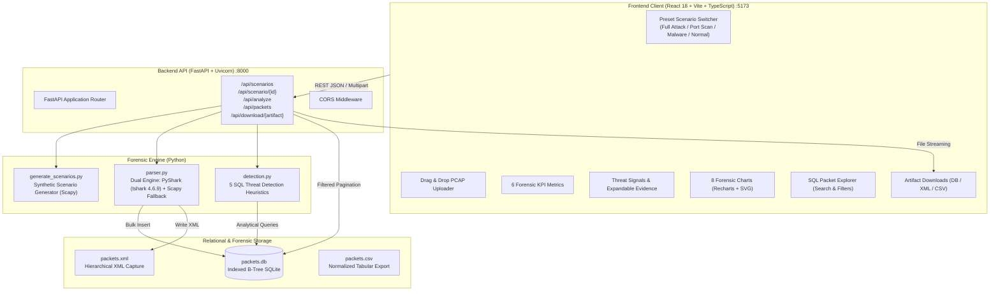

# WireScope

[](LICENSE)
[](https://www.python.org/downloads/)
[](https://fastapi.tiangolo.com/)
[](https://react.dev/)
[](https://www.typescriptlang.org/)
[](https://tailwindcss.com/)
[](https://www.wireshark.org/)

> **A security-focused, institutional forensic network traffic analyzer and threat investigation platform.**  
> Ingests `.pcap` / `.pcapng` packet captures, dissects protocol trees with **PyShark** (backed by native `tshark` or zero-config **Scapy** fallback), normalizes and indexes frames in **SQLite**, executes automated threat detection heuristics mapped to **MITRE ATT&CK**, and visualizes forensic telemetry through a decoupled **React 18 + TypeScript SPA** served by a **FastAPI** backend.

---

## 🎬 Live Interactive Demo


> *High-definition video fallback available at [`docs/demo.mp4`](docs/demo.mp4).*  
> **Live site:** [pcap-analyzer-shep.onrender.com](https://pcap-analyzer-shep.onrender.com) *(free tier: the first visit after idle takes a few seconds to wake up)*

---

## 📌 Executive Summary

Network packet capture analysis is the cornerstone of cyber incident response and digital forensics. However, traditional tools either force investigators into dense, single-frame tabular views (Wireshark) or produce static command-line outputs that are difficult to correlate across macroscopic time windows.

**WireScope** bridges low-level packet dissection with institutional security analytics:
- **Dual-Engine Dissection**: Uses PyShark / tshark 4.6.9 for deep application-layer protocol inspection with automated, zero-configuration Scapy fallback.
- **Relational Forensic Database**: Loads dissected packets into an indexed SQLite database (`packets.db`) with optimized B-Tree queries and hierarchical XML export (`packets.xml`).
- **Automated Threat Detection Engine**: Scans relational records for 5 distinct adversarial patterns: Port Scanning, Insecure Plaintext Protocols, C2 / Backdoor Ports, Heavy Talker Data Exfiltration, and ICMP Ping Sweeps.
- **Preset Threat Scenario Switching**: One-click switching between curated capture scenarios (Full Attack Chain, Port Scan, Malware C2 & Plaintext, Benign Baseline).
- **Institutional Forensic UI**: Clean, restrained design system (`#0f1419` base, `#4a90d9` steel-blue accent, IBM Plex typography) with interactive SVG conversation matrix, Sankey host flows, time-series histograms, and paginated SQL packet explorer.

---

## 🎯 Preset Threat Scenarios

The platform includes a synthetic scenario generation engine (`generate_scenarios.py`) emitting four distinct, reproducible `.pcap` files in `scenarios/`:

| Scenario ID | Name | Severity Profile | Expected Alerts | Injected Forensic Indicators |
|---|---|:---:|:---:|---|
| `full_attack` | **Full Attack Chain** | `CRITICAL` | **5** | Staged SYN scan (42 ports), plaintext credentials (HTTP, FTP, Telnet), 4 C2 backdoor ports (4444, 31337, 6667, 1337), MTU stream (>60% volume), and 40-pkt ICMP sweep. |
| `port_scan` | **Port Scan** | `HIGH` | **1** | Clean baseline traffic combined with a high-speed TCP SYN reconnaissance probe from `192.168.1.99` across 42 distinct target ports. |
| `malware_c2` | **Malware C2 & Plaintext** | `MEDIUM` | **2** | Clean baseline traffic combined with active C2 communication on Metasploit, Back Orifice, IRC, and Elite backdoor channels, plus unencrypted HTTP/FTP/Telnet credential transfers. |
| `normal` | **Benign Baseline** | `CLEAR` | **0** | Normal corporate enterprise network traffic: DNS lookups, TLS 1.3 HTTPS sessions, SSH management sessions, and routine gateway ARP/ICMP heartbeats. Zero threat detections. |

---

## 🛡️ Automated Threat Detection Rules

The detection engine (`detection.py`) executes five automated threat detection heuristics against indexed SQLite records:

| Signal ID | Threat Title | Severity | MITRE ATT&CK | Trigger Heuristic / Detection Logic |
|---|---|:---:|:---:|---|
| `port_scan` | **Port Scan Suspects** | `HIGH` | [T1046](https://attack.mitre.org/techniques/T1046/) | Source IP contacting $\ge 15$ distinct destination ports on a single host. Identifies SYN scan initiators and flags total probes, target host, and time window. |
| `plaintext_protocols` | **Plaintext / Insecure Protocols** | `MEDIUM` | [T1040](https://attack.mitre.org/techniques/T1040/) | Traffic detected on unencrypted service ports (21/FTP, 23/Telnet, 25/SMTP, 80/HTTP, 110/POP3, 143/IMAP) or matching unencrypted application protocols. Highlights credential exposure risks. |
| `suspicious_ports` | **Suspicious / C2 Backdoors** | `MEDIUM` | [T1571](https://attack.mitre.org/techniques/T1571/) | Active traffic on known exploit listeners or botnet channels: 4444 (Metasploit default listener), 31337 (Back Orifice C2), 6667 (IRC botnet), 1337 (Elite backdoor). |
| `heavy_talkers` | **Heavy Talker Traffic Anomaly** | `LOW` | [T1048](https://attack.mitre.org/techniques/T1048/) | Dominant source IP transmitting $>40\%$ of total capture volume and exceeding the 95th percentile byte threshold. Highlights data exfiltration or bandwidth anomalies. |
| `icmp_volume` | **Elevated ICMP Sweep / Flood** | `LOW` | [T1498](https://attack.mitre.org/techniques/T1498/) | Anomalous ICMP count ($\ge 15$ packets or $>2.5\times$ baseline average) sent to single or distributed targets. Identifies ping reconnaissance or low-rate denial of service. |

---

## 🏛️ System Architecture & Data Flow



---

## 📊 Visual Analytics & Telemetry

The dashboard renders eight synchronized analytical visualizations:

1. **Protocol Distribution**: Horizontal breakdown of Network and Transport protocols (TCP, UDP, ICMP, ARP).
2. **Top Talkers by Volume**: Horizontal bar chart identifying bandwidth-dominant source IP addresses.
3. **Capture Timeline**: Dual-axis bar and line chart displaying packet rate and byte throughput per second.
4. **Packet Size Bins**: Histogram grouping frame sizes into forensic buckets (`<100 B`, `100-299 B`, `300-599 B`, `600-999 B`, `1000-1399 B`, `1400+ B`).
5. **Top Destination Ports**: Frequency distribution highlighting insecure ports in crimson and secure services in steel-blue.
6. **Port Scan Temporal Scatter**: Scatter plot displaying probed port numbers versus elapsed seconds to reveal algorithmic scan progression.
7. **Host Communication Flow**: Sankey-style directional flow diagram illustrating source-to-destination byte transfer volumes.
8. **Conversation Matrix**: Two-dimensional SVG heatmap displaying communication density between communicating IP pairs.

---

## 🛠️ Technology Stack

- **Dissection Engine**: [PyShark](https://github.com/KimiNewt/pyshark) (Wireshark `tshark 4.6.9` wrapper) with [Scapy](https://scapy.net/) fallback.
- **Relational Storage**: [SQLite 3](https://sqlite.org/) with B-Tree indexes on `timestamp`, `src_ip`, `dst_ip`, `protocol`, and `dst_port`.
- **Backend Framework**: [FastAPI](https://fastapi.tiangolo.com/) with [Pydantic v2](https://docs.pydantic.dev/) validation and [Uvicorn](https://www.uvicorn.org/) ASGI server.
- **Frontend SPA**: [React 18](https://react.dev/), [TypeScript 5.6](https://www.typescriptlang.org/), [Vite 8](https://vitejs.dev/).
- **Styling & Design System**: [Tailwind CSS 3.4](https://tailwindcss.com/) using an institutional forensic dark palette (`#0f1419`, `#1a1f29`, `#4a90d9`).
- **Typography**: [IBM Plex Sans](https://fonts.google.com/specimen/IBM+Plex+Sans) (interface) & [IBM Plex Mono](https://fonts.google.com/specimen/IBM+Plex+Mono) (telemetry and logs).
- **Visualization Library**: [Recharts 2.15](https://recharts.org/) and native SVG components.
- **E2E Automation & Verification**: [Playwright](https://playwright.dev/) and [FFmpeg](https://ffmpeg.org/) for automated UI recording and GIF generation.

---

## 🚀 Quickstart & Local Installation

### Prerequisites

- **macOS / Linux / Windows WSL2**
- **Python 3.10+**
- **Node.js 18+ & npm**
- **Wireshark / tshark** *(optional — Scapy fallback engages automatically if tshark is absent)*
- **FFmpeg** *(optional — only required for recording demo GIFs)*

### 1. Clone the Repository

```bash
git clone https://github.com/savya14/pcap-analyzer.git
cd pcap-analyzer
```

### 2. Set Up Python Virtual Environment

```bash
python3 -m venv .venv
source .venv/bin/activate
pip install -r requirements.txt
playwright install chromium
```

### 3. Install Frontend Dependencies

```bash
cd frontend
npm install
cd ..
```

### 4. Generate Threat Scenarios

```bash
python generate_scenarios.py
```

### 5. Launch Both Servers with One Command

Run the unified runner script:

```bash
./run_all.sh
```

Or launch each service in separate terminals:

```bash
# Terminal 1 — FastAPI Backend (Port 8000)
source .venv/bin/activate
uvicorn backend.main:app --host 0.0.0.0 --port 8000 --reload

# Terminal 2 — Vite React Frontend (Port 5173)
cd frontend
npm run dev -- --host 0.0.0.0 --port 5173
```

Open your browser to: **`http://localhost:5173`**

---

## 📡 REST API Reference

The FastAPI backend exposes the following REST endpoints on `http://localhost:8000`. Every endpoint except `/api/scenarios` requires an `X-Session-Id` header (8–64 characters, `A-Za-z0-9_-`); the frontend sends one automatically.

| Method | Endpoint | Query / Body Parameters | Response | Description |
|---|---|---|---|---|
| `GET` | `/api/health` | None | `HealthResponse` | Health status, active parser engine, indexed packet count, and database state. |
| `GET` | `/api/scenarios` | None | `List[ScenarioInfo]` | Metadata for all 4 preset threat scenarios (id, name, severity, expected alerts). |
| `GET` | `/api/scenario/{id}` | Path: `id` | `AnalysisResponse` | Executes the full forensic pipeline on `scenarios/{id}.pcap` and returns the complete dashboard payload. |
| `GET` | `/api/sample` | None | `AnalysisResponse` | Analyzes bundled `sample.pcap` (Full Attack Chain) and returns the dashboard payload. |
| `POST` | `/api/analyze` | `multipart/form-data` file | `AnalysisResponse` | Ingests an uploaded `.pcap` or `.pcapng` file, parses, indexes, runs detections, and returns the payload. |
| `GET` | `/api/packets` | `protocol`, `search`, `port`, `host`, `src`, `dst`, `alert`, `limit`, `offset` | `PaginatedPacketsResponse` | Server-paginated packet rows backed by SQL queries with search and filter capabilities. |
| `GET` | `/api/download/{artifact}` | Path: `db`, `xml`, or `csv` | `FileResponse` | Streams raw forensic artifacts (`packets.db`, `packets.xml`, or `packets.csv`) for offline review. |

---

## 🎥 Recording Demo Videos & GIFs

To re-record the automated demo video and generate an optimized `<8MB` GIF:

```bash
source .venv/bin/activate
python record_demo.py
```

This drives a headless Playwright Chromium instance through interactive scenario switching, expands threat evidence tables, performs SQL packet filtering, and encodes:
- `docs/demo.gif` (high-quality two-pass palette GIF, ~5.8 MB)
- `docs/demo.mp4` (H.264 video, ~1.0 MB)

---

## 🌐 Production Deployment Guide

The app deploys as **one service**: the Docker image builds the React frontend and the FastAPI backend serves it
alongside the API, so there is a single public URL and no CORS setup.

### Deploy on Render (free tier)

1. Push this repository to GitHub.
2. In Render, choose **New → Blueprint** and select the repository. `render.yaml` defines the service.
3. Wait for the Docker build to finish, then open the generated `https://<name>.onrender.com` URL.

Railway and Fly.io work the same way: point them at the `Dockerfile`. Free tiers sleep when idle, so the first
request after a quiet period takes a few seconds.

### Multi-user behaviour

Every browser gets a random session id (sent as `X-Session-Id`). The backend keeps one SQLite/XML pair per session in
`data/sessions/`, so visitors never see each other's uploads, and files are deleted after `SESSION_TTL_SECONDS`.

| Environment variable | Default | Purpose |
|---|---|---|
| `PORT` | `8000` | Port the server listens on (set by most hosts). |
| `MAX_UPLOAD_MB` | `25` | Largest accepted capture upload. |
| `SESSION_TTL_SECONDS` | `3600` | How long a visitor's database is kept. |
| `SESSIONS_DIR` | `data/sessions` | Where per-session files are written. |
| `ALLOWED_ORIGINS` | localhost dev origins | Only needed if the frontend is hosted on a different origin. |
| `VITE_API_BASE` | *(unset)* | Build-time API URL, only for a separately hosted frontend. |

> Uploaded captures are processed on the server. Don't expose the public site to captures you consider sensitive.

---

## 📂 Repository File Tree

```text
PCAP/
├── backend/
│   ├── __init__.py
│   └── main.py                 # FastAPI service wrapping forensic modules & REST endpoints
├── frontend/
│   ├── index.html              # HTML5 entry point with IBM Plex typography
│   ├── package.json            # Vite, React 18, Tailwind, Recharts dependencies
│   ├── tailwind.config.js      # Institutional slate & steel-blue forensic color system
│   ├── tsconfig.json           # Strict TypeScript configuration
│   └── src/
│       ├── api.ts              # Type-safe API client for backend communication
│       ├── App.tsx             # Root React container with scenario & analysis state
│       ├── index.css           # Custom scrollbars, badge styling, and utilities
│       ├── main.tsx            # React DOM bootstrap
│       ├── types.ts            # Complete TypeScript interfaces for forensic payloads
│       └── components/
│           ├── ChartsGrid.tsx      # 8 interactive forensic charts (Recharts + SVG)
│           ├── Footer.tsx          # System metadata and raw artifact download links
│           ├── Header.tsx          # Institutional header with live parser engine badge
│           ├── KpiRow.tsx          # 6 high-level forensic metric indicator cards
│           ├── PacketExplorer.tsx  # Paginated SQL packet table with live filters
│           ├── ScenarioSwitcher.tsx# Horizontal preset threat scenario selection row
│           ├── ThreatSignals.tsx   # Threat cards with expandable evidence tables
│           └── UploadControl.tsx   # Drag-and-drop file upload & sample reload
├── docs/
│   ├── demo.gif                # Optimized high-definition interactive demo GIF (<8MB)
│   └── demo.mp4                # H.264 video demo fallback
├── scenarios/
│   ├── full_attack.pcap        # 602 packets, all 5 threat signals (CRITICAL)
│   ├── port_scan.pcap          # 557 packets, staged SYN port scan (HIGH)
│   ├── malware_c2.pcap         # 503 packets, backdoor ports & unencrypted creds (MEDIUM)
│   └── normal.pcap             # 473 packets, benign baseline traffic (CLEAR)
├── detection.py                # SQL threat detection engine (5 heuristic modules)
├── generate_sample.py          # Scapy synthetic attack capture generator
├── generate_scenarios.py       # Scapy multi-scenario PCAP generator
├── parser.py                   # PyShark/Scapy dual-engine dissector, SQLite & XML exporter
├── record_demo.py              # Automated Playwright demo video recorder & GIF encoder
├── Dockerfile                  # Multi-stage build: React frontend + FastAPI backend
├── render.yaml                 # One-click Render blueprint
├── run_all.sh                  # Single-command launcher for backend and frontend
├── requirements.txt            # Python dependencies (pyshark, scapy, fastapi, etc.)
└── README.md                   # Public documentation & architecture guide
```

---

## 🎓 Academic & Forensic Context

This project was built for an **Information Security Lab** curriculum implementing:
1. **Module 1: PCAP Analysis: PCAP to SQLite (and PCAP to XML)**
   - Granular packet dissection extracting 10 normalized network and transport attributes.
   - Atomic bulk insertion into relational SQLite databases with optimized B-Tree query indexes.
   - Standard-compliant hierarchical XML capture serialization.
2. **Module 2: Traffic Analysis: PyShark**
   - High-throughput asynchronous packet dissection utilizing Wireshark's native `tshark` engine.
   - Robust error handling with dynamic Scapy fallback.
   - Heuristic anomaly correlation identifying malicious signatures across time and protocol layers.

---

## ⚖️ License

Distributed under the **MIT License**. See `LICENSE` for details.
